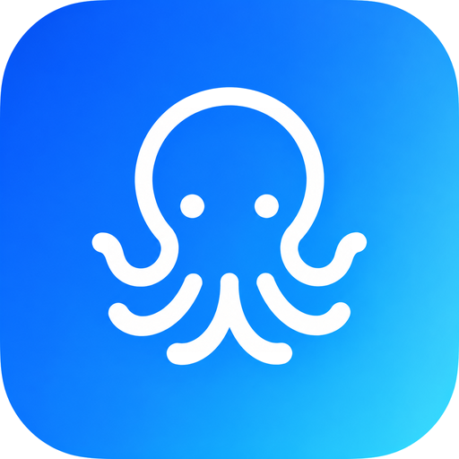
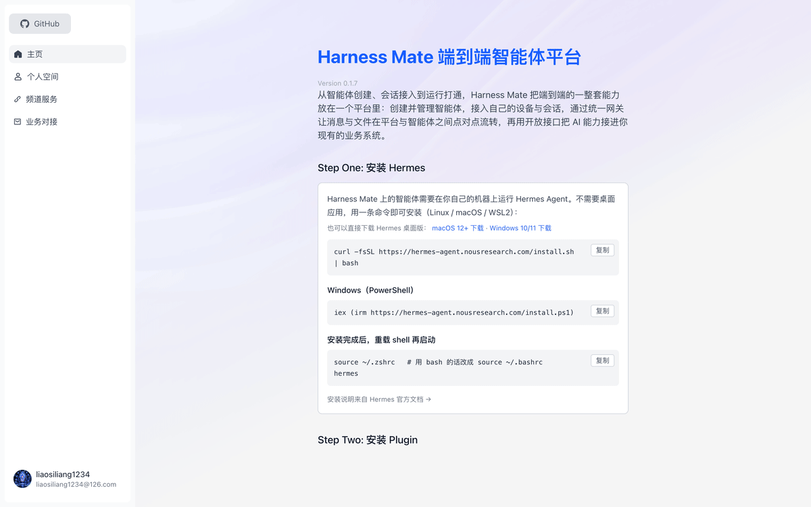
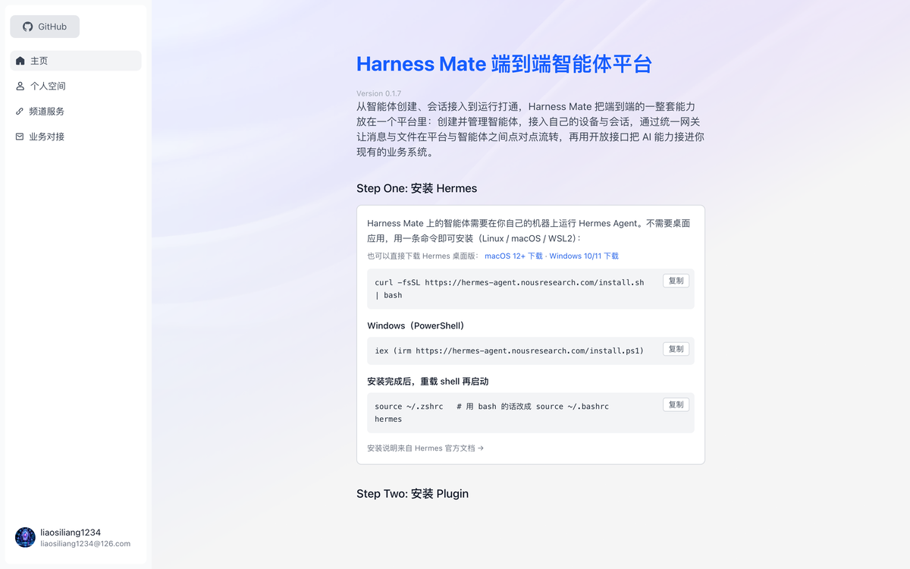
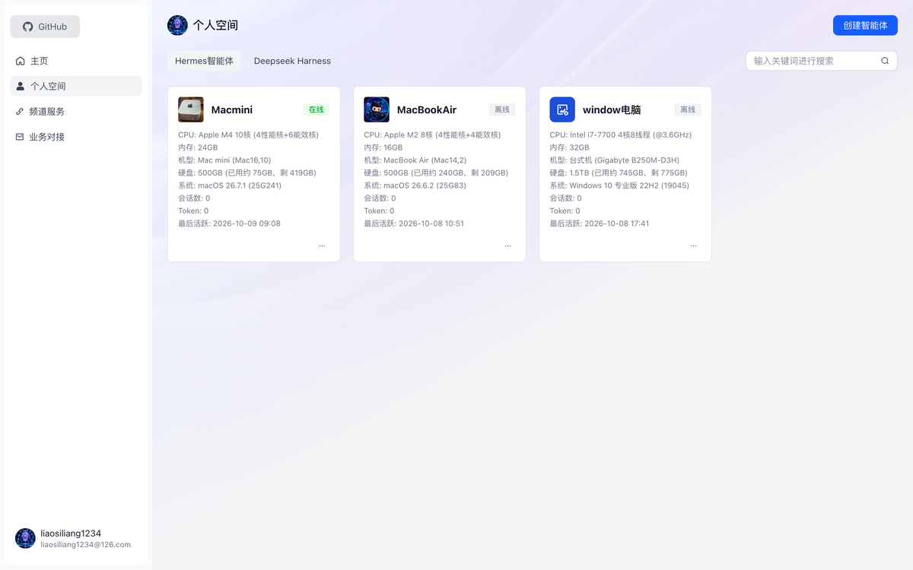
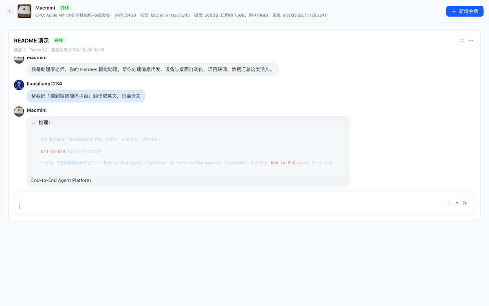

<p align="center">
  
</p>

<h1 align="center">HarnessMate — a DeepSeek Harness plugin</h1>

<p align="center">
  Put the DeepSeek Harness agent running on <b>your own computer</b> into your pocket.<br />
  <b>English</b> · <a href="README.zh.md">中文</a>
</p>

<p align="center">
  <a href="LICENSE"></a>
  
  
</p>

<p align="center">
  
</p>

`harness-mate` is a [DeepSeek Harness](https://github.com/deepseek-ai/deepseek-harness) (`dsh`) plugin. It connects the DSH agent running on your machine to **[HarnessMate](https://github.com/liaosiliangCodeLife/harness-mate-plat)** — a small self-hostable platform that gives that agent a phone app and a browser entry.

The agent keeps running on your own computer, with your files and your approvals. HarnessMate is just the door: open it from the phone in your pocket or from a browser anywhere.

## What it does

- **Chat from anywhere.** Send the agent a message from the phone app or the web UI; streamed replies arrive with a typing indicator.
- **Files both ways.** Send the agent files from the phone; the agent can send files back.
- **Approvals on your phone.** When the agent asks to run a risky tool, the request is pushed to you — approve or deny from the chat, instead of being tied to the computer.
- **Keeps your machine in charge.** Tools run locally with your permissions, under your DSH profile. HarnessMate never executes anything on its own.
- **Model-agnostic and profile-aware.** It talks to whatever model your DSH profile is configured with.
- **macOS and Windows.**

## Install

You need a HarnessMate agent — a `bot_id` and a `bot_key`.
Open the platform (`https://harness.alltman.com` by default), sign in, go to **个人空间 → 创建智能体**, and copy both values. **The key is shown only once.**

> DeepSeek Harness desktop **v0.2.0-rc.2 or newer**, started at least once, is required.

### Option A — install as a plugin (recommended)

```sh
dsh plugin --profile web add github:liaosiliangCodeLife/harness-mate-dsh
```

Once the package is on npm this shortens to `dsh plugin --profile web add harness-mate`.

Then put your credentials in the **profile** config — `~/.dsh/profiles/desktop/cordis.patch.yml` (macOS) / `%USERPROFILE%\.dsh\profiles\desktop\cordis.patch.yml` (Windows):

```yaml
- insert:
    - id: harness-mate
      name: 'harness-mate'
      config:
        gatewayUrl: 'wss://ws-agent.alltman.com:1443/ws'
        botId: 'YOUR_BOT_ID'
        botKey: 'YOUR_BOT_KEY'
```

### Option B — run the installer

Download the release zip, unpack it, and run the installer in the plugin folder. It registers the plugin, links it into the profile, writes your credentials, and backs up the previous config — 3 steps, no manual editing.

```bash
# macOS
cd harness-mate
./install.sh            # or: ./install.sh <bot_id> <bot_key>
```

```powershell
# Windows
powershell -ExecutionPolicy Bypass -File .\install.ps1
```

### Both options finish the same way

**Quit DeepSeek Harness completely** (menu bar / tray icon → Quit — not just close the window) and start it again. Then send the agent a message from the phone app or the web UI: **a reply means it works.** Logs are written to `~/.harness-mate-trace.log` (`%USERPROFILE%\.harness-mate-trace.log` on Windows).

Detailed instructions, FAQ and the full configuration reference: **[INSTALL.md](INSTALL.md)**.

## Configuration

Every field lives under `config` in the plugin's `cordis.patch.yml`; change them and restart DSH.

| field | default | meaning |
|---|---|---|
| `gatewayUrl` | HarnessMate's gateway | The WebSocket gateway the plugin connects to |
| `botId` / `botKey` | — | This agent's identity on the platform (**required**) |
| `workspace` | your home directory | Root directory the agent may read and write |
| `dmPolicy` | `open` | `open` · `allowlist` (with `allowFrom`) · `disabled` |
| `approvalTimeoutMs` | `300000` | Tool-approval timeout; a timeout is treated as a denial |
| `apiBaseUrl` | derived from `uploadUrl` | Platform HTTP API root (incl. `/api`) for approval polling |
| `internalToken` | — | Must match platform `INTERNAL_TOKEN`; without it polling is disabled |
| `agentId` | — | Agent UUID; defaults to lookup by `botId` |
| `maxReplyChars` | `4000` | Maximum length of a single reply |
| `forwardReasoning` | `false` | Also forward the agent's reasoning to the chat |

## Screenshots

| Home | Personal space | Chat |
|---|---|---|
|  |  |  |

## Repository layout

```
harness-mate-dsh/
├── index.js            # the plugin (DSH / Cordis)
├── package.json        # manifest: dsh.bundle patch + icon
├── cordis.patch.yml    # default plugin config
├── icon.svg            # plugin icon shown in DSH
├── locale/             # zh / en title and description
├── install.sh          # macOS installer
├── install.ps1         # Windows installer (PowerShell)
└── INSTALL.md          # full install guide, FAQ, manual install
```

## Related

- **[harness-mate-plat](https://github.com/liaosiliangCodeLife/harness-mate-plat)** — the platform itself (Vue 3 + Flask + Go WebSocket gateway + Docker), MIT licensed and self-hostable.
- The sibling **Hermes** channel adapter lives in that repository under `plugin/hermes/`.

## License

[MIT](LICENSE)
